<div align="center">

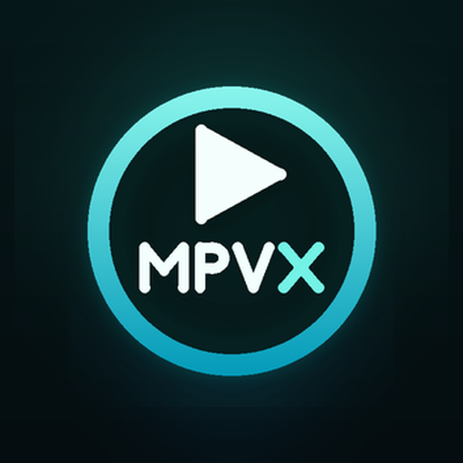

# MPVX Player

### Dual-Engine 4K HDR Video & Hi-Res Music Studio for Android

Developed by **Creative Mind Studio** (`com.cmstudio.player`)

[-3DDC84?style=flat-square&logo=android&logoColor=white)](#requirements--tech-stack)
[](#build-from-source)
[](#dual-playback-engines)
[](LICENSE)

<br /><br />

<a href="https://play.google.com/store/apps/details?id=com.cmstudio.player">
  
</a>

<br /><br />

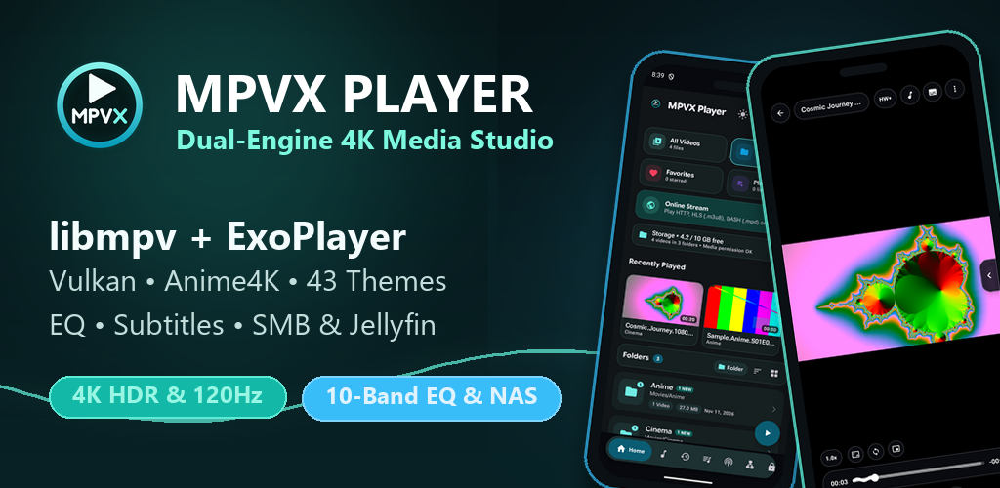

</div>

---

## Screenshots

### Phone Experience

<table>
  <tr>
    <td align="center" width="25%">
      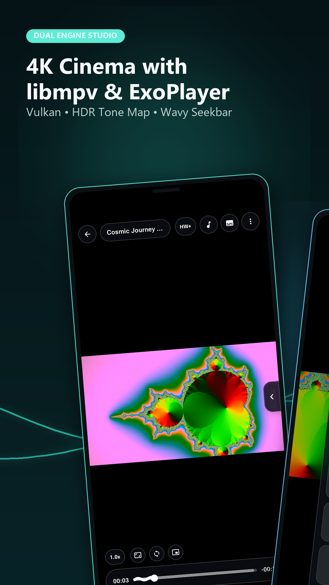
      <br /><sub><b>Dual-Engine Cinema</b></sub>
    </td>
    <td align="center" width="25%">
      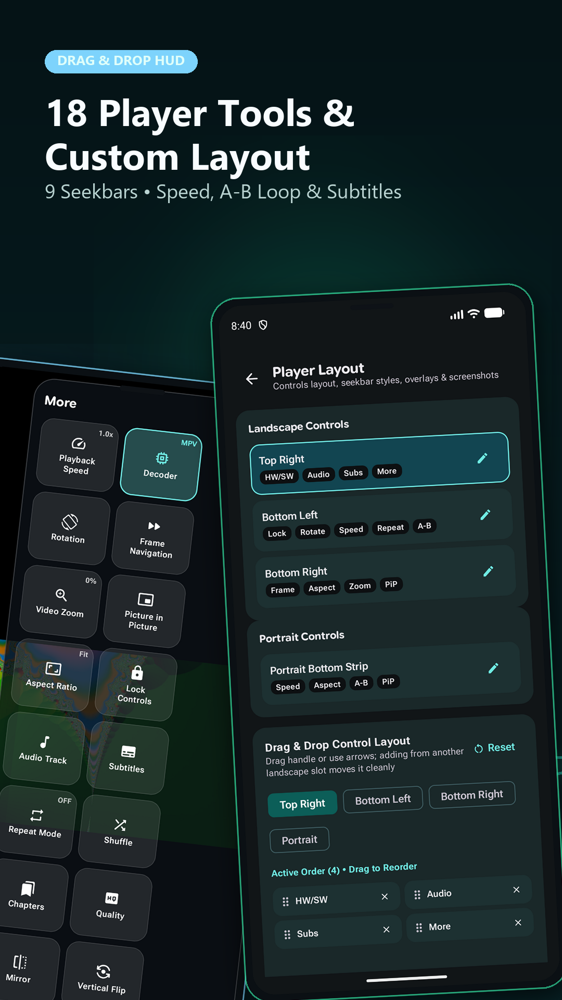
      <br /><sub><b>18 Tools & HUD Editor</b></sub>
    </td>
    <td align="center" width="25%">
      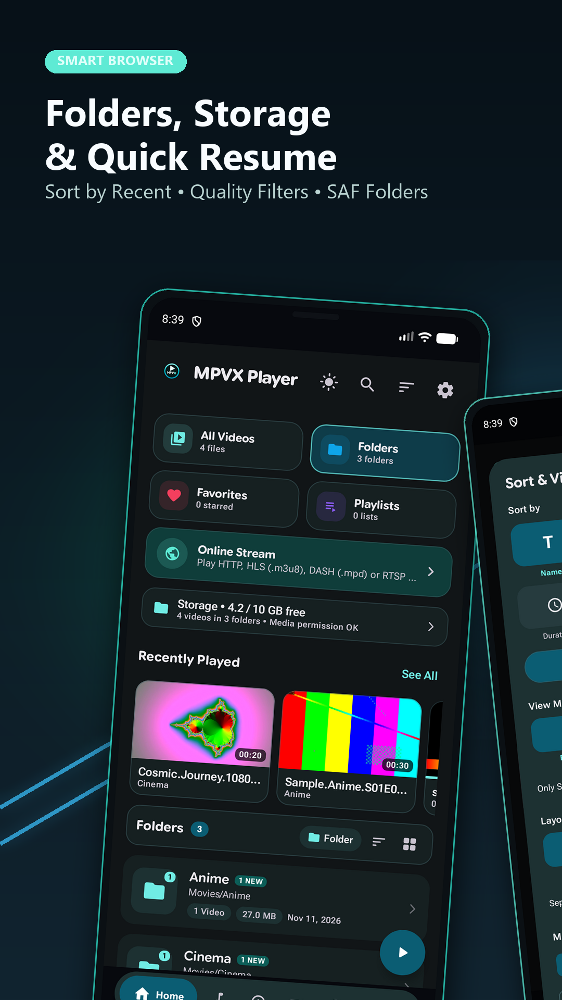
      <br /><sub><b>Smart Media Browser</b></sub>
    </td>
    <td align="center" width="25%">
      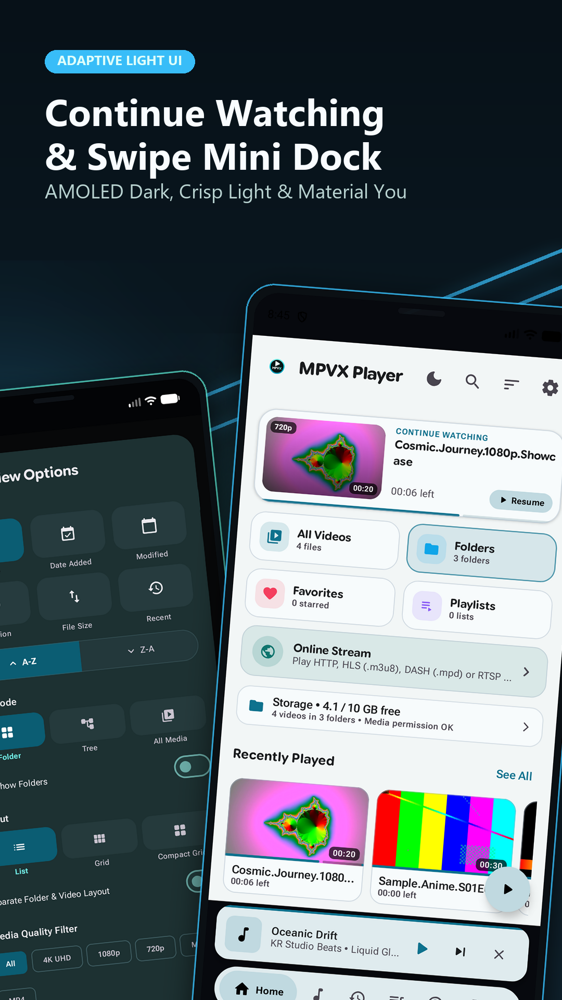
      <br /><sub><b>Adaptive Light & Mini Dock</b></sub>
    </td>
  </tr>
  <tr>
    <td align="center" width="25%">
      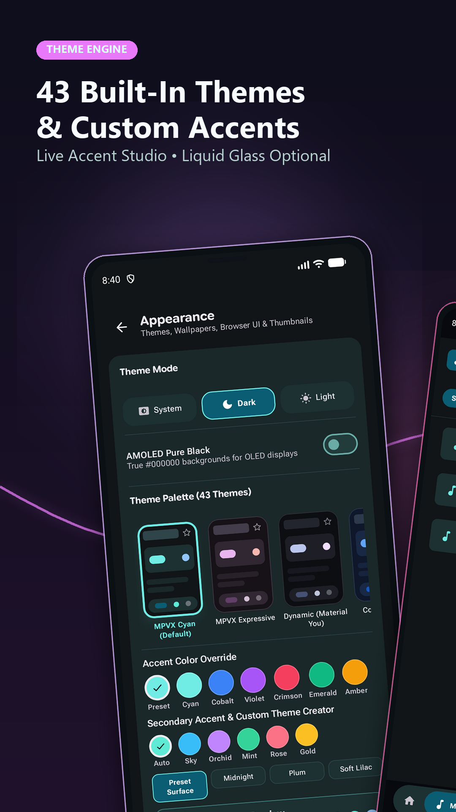
      <br /><sub><b>43 Themes & Custom Accents</b></sub>
    </td>
    <td align="center" width="25%">
      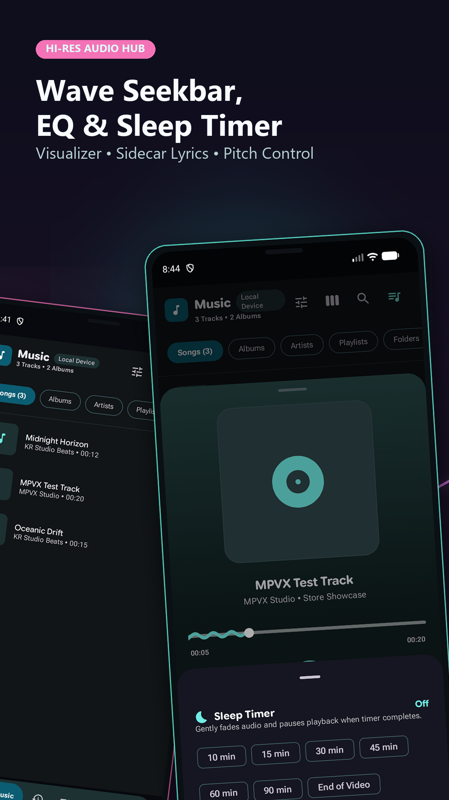
      <br /><sub><b>Music Studio, EQ & Timer</b></sub>
    </td>
    <td align="center" width="25%">
      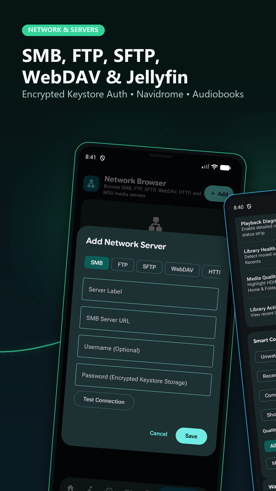
      <br /><sub><b>SMB / SFTP / WebDAV / Jellyfin</b></sub>
    </td>
    <td align="center" width="25%">
      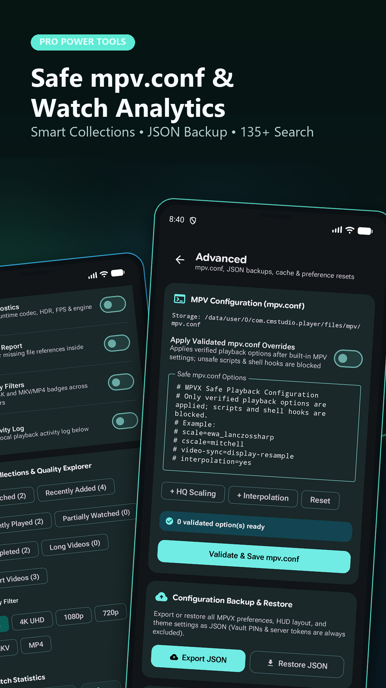
      <br /><sub><b>Safe mpv.conf & Backup</b></sub>
    </td>
  </tr>
</table>

### Tablet & Widescreen

<table>
  <tr>
    <td align="center" width="50%">
      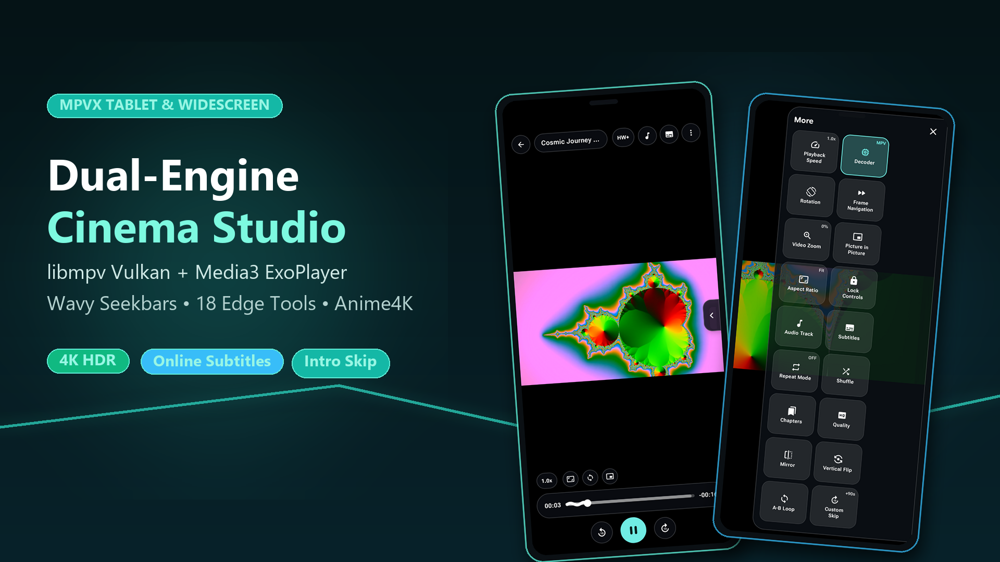
      <br /><sub><b>Widescreen Player & Quick-Tools Grid</b></sub>
    </td>
    <td align="center" width="50%">
      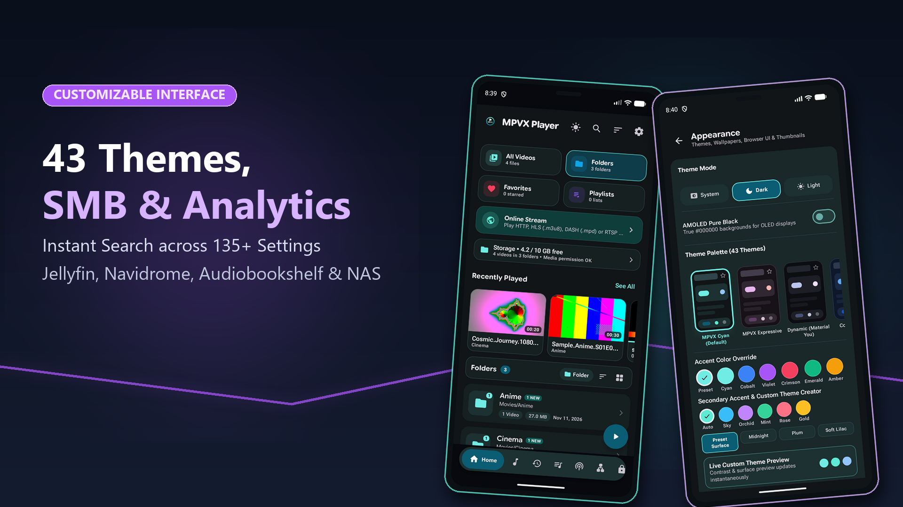
      <br /><sub><b>Customizable Interface & Theme Studio</b></sub>
    </td>
  </tr>
</table>

---

## Detailed Features

### Dual Playback Engines
- **Auto Engine Routing**: Automatically selects between **libmpv** and **AndroidX Media3 (ExoPlayer)** per stream/codec, or switch manually (`Auto`, `libmpv`, `ExoPlayer`) directly inside the player.
- **Native libmpv Power**: Vulkan, `gpu-next`, and OpenGL ES video backends, 10-bit HDR (HDR10 / HLG) tone-mapping, frame timing, debanding, and software/MediaCodec decoder fallback.
- **Media3 ExoPlayer & Bundled Decoders**: Hardware-accelerated playback with dedicated extensions for **FFmpeg**, **AV1 (`dav1d`)**, **IAMF**, and **MPEG-H**.
- **Anime4K GLSL Shaders**: Built-in Anime4K v4.x real-time upscaling and line-restoration shader presets (`app/src/main/assets/shaders/anime4k/`).

### Customizable Player HUD & Gestures
- **Drag-and-Drop HUD Layout Editor**: Customize every button across Landscape (`Top Right`, `Bottom Left`, `Bottom Right`) and Portrait (`Bottom Strip`) slots.
- **9 Seekbar Styles**: Switch between Normal, Standard, Wavy, Thick, Slim, Segmented, Dual Glow, Pulse Bar, and minimal styles with floating live scrub timestamp preview.
- **Full Gesture Suite**: Independent left/right vertical swipes for brightness and volume, horizontal scrub seeking, customizable double-tap left/center/right zone actions, pinch-to-zoom & pan, 2x long-press speed boost, and clean screen lock with auto-hiding unlock pill.
- **18 Quick Player Tools**: Speed presets (`0.25x`–`4.0x`), A-B loop, frame-by-frame stepping, Picture-in-Picture (PiP), aspect ratio modes (`Fit`, `Fill`, `16:9`, `4:3`, etc.), mirror & vertical flip, orientation lock, chapters, and video snapshots.

### Subtitles & Hi-Res Audio
- **Full Subtitle Stack**: Styled **ASS/SSA (`libass`)**, SRT, WebVTT, TTML, and SAMI rendering, embedded bitmap/PGS support, dual-subtitle display, live sync delay, playback speed matching, custom fonts, and outline/background edge tuning.
- **Online Subtitle Search**: Built-in lookup via Wyzie (and optional user SubDL API key) to download and attach matching subtitles on the fly.
- **Intro & Outro Skip**: Embedded Matroska chapter markers and optional skip controls.
- **Music Studio & Audio DSP**: Dedicated audio browser (`Songs`, `Albums`, `Artists`, `Playlists`, `Folders`), 10-band Equalizer presets, loudness boost, pitch correction, audio channel downmix, synced `.lrc`/sidecar lyrics viewer, wave visualizer, and gentle fade-out sleep timer.

### Smart Local Library & Privacy Vault
- **Organized Media Browser**: MediaStore indexing with **List**, **Grid**, **Compact Grid**, **Folder**, and **Tree** views, plus optional **Storage Access Framework (SAF)** folder mounts for SD cards/USB drives.
- **Smart Collections & Quality Filters**: One-tap filters for `4K UHD`, `1080p`, `720p`, `MKV`, `MP4`, Unwatched, Recently Added, Partially Watched, Completed, and Watch Statistics.
- **PIN-Protected Privacy Vault**: Lock sensitive local videos behind an encrypted PIN-gated vault.

### Network Shares & Self-Hosted Media Servers
- **Direct LAN / Cloud Protocols**: Browse and stream seamlessly over **SMB**, **FTP**, **SFTP**, **WebDAV**, **HTTP/HTTPS directories**, and **M3U playlists** via an integrated local range-streaming bridge.
- **Media Server Integrations**: Connect directly to **Jellyfin**, **Navidrome (Subsonic)**, and **Audiobookshelf** libraries.
- **Keystore Encryption**: Saved server credentials are encrypted with **Android Keystore** (`EncryptedSharedPreferences` / AES-GCM).

### Themes, Settings Search & Safe Configuration
- **43 Built-In Material 3 Themes**: Including `MPVX Cyan (Default)`, `MPVX Expressive`, `Dynamic (Material You)`, Light/Dark/System modes, true `#000000` AMOLED Pure Black, optional Liquid Glass surface blur, and a **Live Custom Theme Creator**.
- **Search Across 135+ Settings**: Fast fuzzy settings index covering playback, HUD, subtitles, audio, library, network, and theme preferences.
- **Validated `mpv.conf` & JSON Backups**: Apply safe verified `mpv.conf` overrides (unsafe scripts & shell hooks are blocked) and export/restore settings as JSON (`Privacy Vault PINs` and server tokens are always excluded).

---

## Requirements & Tech Stack

| Specification | Detail |
|---|---|
| **Package ID** | `com.cmstudio.player` |
| **Minimum Android** | Android 7.1 (API 25) |
| **Target SDK** | Android 16 (API 36) / Compile SDK 37 |
| **16 KB Page Size** | All 64-bit native `.so` binaries aligned to 16 KB (`arm64-v8a`, `x86_64`) |
| **UI Framework** | Kotlin + Jetpack Compose Material 3 Expressive |
| **Playback Core** | `libmpv` (`mpvlib.aar`) + AndroidX Media3 (`ExoPlayer` + FFmpeg/AV1/IAMF/MPEG-H) + `libass` |

---

## Build from Source

```bash
git clone https://github.com/CM-Studio77/mpvx.git
cd mpvx
```

1. *(Optional for Release Signing)* Copy [`keystore.properties.example`](keystore.properties.example) to `keystore.properties` and point it to your release keystore (debug builds work without a keystore).
2. Build or verify using the Gradle wrapper:

```bash
# Run unit tests (81 tests)
./gradlew :app:testLatestUniversalDebugUnitTest

# Build Debug APK
./gradlew :app:assembleLatestUniversalDebug

# Run release lint + build signed Universal APK & Play App Bundle
./gradlew :app:lintVitalLatestUniversalRelease :app:assembleLatestUniversalRelease :app:bundleLatestUniversalRelease
```

---

## Permissions & Privacy

MPVX Player is offline-first and makes **no background telemetry or analytics connections**:

- **Video & Audio Library (`READ_MEDIA_VIDEO` / `READ_MEDIA_AUDIO`)**: Used solely to scan local folders, duration, resolution, sidecar subtitles (`.srt`, `.ass`, `.ssa`, `.vtt`), and resume playback positions.
- **Optional SAF Storage Access**: Lets you grant explicit access to external USB/SD card directories.
- **Network Requests**: Triggered only when you explicitly stream a network URL/LAN share or request an online subtitle search.

See [`SECURITY.md`](SECURITY.md) for security reporting details.

---

## Open-Source License

**MPVX Player** is free open-source software licensed under the **GNU General Public License v3.0** ([`LICENSE`](LICENSE)).

Bundled core engines and libraries (`libmpv`, `FFmpeg`, `libass`, `AndroidX Media3`, `Anime4K` shaders, `SMBJ`, `JSch`, `NanoHTTPD`, `OkHttp`, `Coil`, etc.) remain under their respective open-source licenses. Full texts and attributions are included inside [`THIRD-PARTY-NOTICES.md`](THIRD-PARTY-NOTICES.md), [`licenses/`](licenses/), and in-app under **Settings → About → Open-Source Licenses**.
